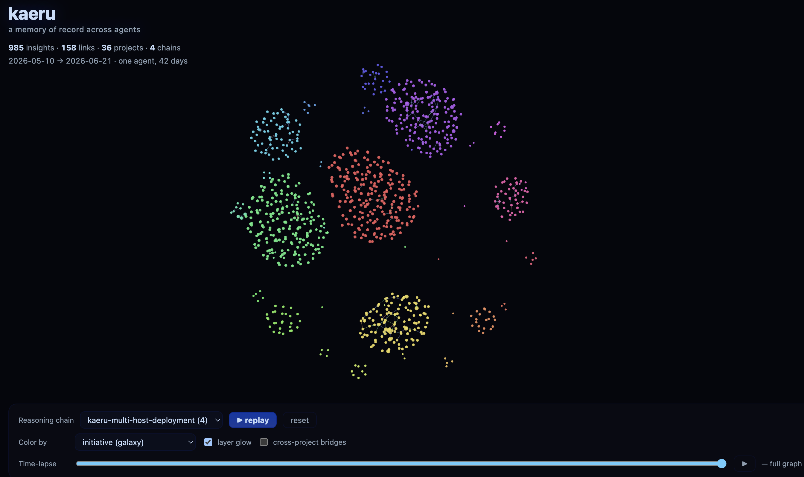

# 蛙 kaeru

`kaeru` is a **cross-agent cognitive engine** for LLM agents — a typed graph that agents think in, plus a recollection layer for long-term ideas and outcomes. Local-first for each agent, with an optional shared cloud tier so a whole team of agents and people build on one another's memory.

Designed for **multi-session, multi-agent continuity**: when an agent opens a project, it has full context of what was being thought about, can follow provenance chains, can consolidate outcomes into stable long-term knowledge, and can pull in what the rest of the team has shared.

Inspired by the LLM-wiki pattern (Karpathy, gist `442a6bf555914893e9891c11519de94f`), the bi-temporal knowledge graph approach of Graphiti / Zep, the curator-driven knowledge engine of Cognee, and the reasoning-based hierarchical-summary navigation pattern from PageIndex. Two-tier design grounded in the hippocampus / cortex split.

Name: 蛙 (*kaeru*, "frog"; homophonic with 帰る "to return" and 変える "to change") — the agent that returns, recalls, and reshapes.


<sub>A kaeru vault rendered by [`kaeru-viz`](kaeru-viz/) — each project a constellation of stars around its core, sized by memory layer, with ochre cross-project bridges, reasoning-chain replay, and a time-lapse of how the knowledge grew. Hover a node to trace its neighbours; click to pin them.</sub>

## Overview



`kaeru` is built around a typed property graph stored in CozoDB. Two tiers, biological analogy:

- **cognitive (operational / hippocampus)** — high-velocity working graph where the agent actively thinks: episodes, scratch, drafts, hypotheses, experiments, audit events.
- **recollection (archival / cortex)** — settled ideas, outcomes, summaries, references; mostly read.

Nodes and edges retain recorded assertion/retraction history, so earlier content remains inspectable after a change. The store has one recorded-time axis; current metadata such as layer and visibility is not a full historical snapshot.

Per-initiative subgraphs through a junction-relation pattern: one substrate, many initiatives, multi-membership. An agent working on project A asks "what was I doing here last time?" and gets an answer scoped to A. The same node can belong to several initiatives at once.

`kaeru` is a **facilitator, not an enforcer**. The memory API exposes 35 named operations (`context`, `search`, `read`, `claim`, `synthesise`, `history`, `lifecycle`, …) as available tools. The agent and user choose when to invoke them; the daemon hints but doesn't block.

## Memory operations

The agent API has 35 named tools: 16 frequent operations, ten local maintenance
operations and nine optional cloud operations. [The API reference](docs/curator-api.md)
explains the catalogue, shared JSON results and paging. There is no query DSL.
MCP, HTTP and embedded Rig share their schemas and local command implementation.

Records live in operational or archival tiers and in five independent recall
layers. Explicit typed edges preserve provenance, doubts, dependencies and
succession; authored trails retain why a conclusion was reached. `context`
restores rules, current records and unfinished work. Ordinary reads carry
currentness, conflicts and saved reasoning. `reference` preserves supplied
source text exactly, and `verdict` can record evidence and status atomically.

The embedded Cozo/RocksDB substrate preserves recorded assertions and retractions.
`history` and `read(recorded_at=...)` inspect earlier content. Current metadata
is labeled as current; there is one recorded-time axis, not a separate axis for
when a fact was true in the world. Intrinsic mutations, audit and replay records
commit together. Existing vaults migrate on open without removing their history; old unscoped
records are recovered under `legacy-unscoped`.

## Update checks

The daily update check asks `updates.lamantin-ai.com` for the public GitHub
release listing and falls back to GitHub when the endpoint is unavailable.
Its User-Agent includes the kaeru version, OS/architecture, installation
channel and environment. The endpoint keeps daily aggregate counts using
salted IP/User-Agent fingerprints, deleting the daily salt and hashes on the
next sweep; no vault content is sent. Set `KAERU_MCP_UPDATE_CHECK=0` to disable
the check. See [the update Worker](contrib/update-worker/) for storage and
counting details.

## Layout

```
kaeru/
├── Cargo.toml                  ← workspace root
├── kaeru-core/                 ← library: substrate, schema, primitives
├── kaeru-mcp/                  ← binary `kaeru-mcp`: Model Context Protocol server (the agent's surface)
├── kaeru-cloud/                ← binary `kaeru-cloud`: shared cloud tier (Axum REST over kaeru-core)
├── kaeru-rig/                  ← library: `rig` Tools that give a rig agent kaeru memory
└── skills/
    └── kaeru-skill/            ← portable agent skill (Claude Code / etc.)
```

`kaeru-rig` is the [rig](https://github.com/0xPlaygrounds/rig) framework adapter — the full curator verb set as discrete rig `Tool`s over an embedded `Arc<Store>`, so a rig agent reads and writes one vault. Future: `kaeru-langchain` (Python bridge), not yet started.

## Install

> **Pre-1.0 alpha.** Substrate schema may change between minor versions —
> export to markdown if you need to keep notes around.

See [QUICK_START.md](QUICK_START.md) for source builds, MCP daemon setup, and the re-entry ritual.

## Quick tour (MCP tools)

```text
context(initiative="auth-rewrite")
note(initiative="auth-rewrite", body="Token expiry differs across platforms")
search(initiatives=["auth-rewrite"], text="expiry", prefix=true)
read(initiative="auth-rewrite", node="<returned uuid>")
claim(initiative="auth-rewrite", text="Platform-aware policy is correct")
verdict(initiative="auth-rewrite", hypothesis="<returned uuid>",
        status="supported", evidence={"method":"Compared iOS and Android TTL"})
history(initiative="auth-rewrite", node="<uuid>")
read(initiative="auth-rewrite", node="<uuid>", recorded_at="2026-10-01T12:00:00Z")
```

Follow `continuation.next_arguments` and inspect `coverage` on bounded reads.
A `partial` mutation can contain a committed local record; inspect its IDs and
failed steps. Hosts can supply `request_id` to recover an uncertain outcome.

## Building without network access

Some machines cannot reach crates.io. The dependencies for each release are
vendored into a separate repository, [`LamantinAI/kaeru-vendor`](https://github.com/LamantinAI/kaeru-vendor),
one tag per release:

```bash
git checkout v0.7.3
./contrib/offline/fetch-vendor.sh     # ~600 MB, needs network once
# carry the whole directory across, then:
cargo build --release --offline -p kaeru-mcp
```

Rust alone is not enough on either side of that line — cozo builds RocksDB from
C++ and zstd/lz4 from C, so a C++ toolchain and `libclang` are needed whether or
not you are offline. See [docs/offline-build.md](docs/offline-build.md) for the
per-platform requirements and the Windows line-ending trap that fails every
checksum at once.

## Connecting to an MCP-aware agent

`kaeru-mcp` is a long-lived HTTP service: **one daemon per machine** owns the substrate, any number of agent sessions (Claude Code, Opencode, Cursor, …) connect concurrently. This is intentional — RocksDB is single-writer, so a stdio MCP that forks a subprocess per session would hit lock contention. See `kaeru-mcp/README.md` for systemd / launchd unit templates and the full HTTP config.

Run the daemon (or set up the systemd user unit from `contrib/install/`):

```bash
kaeru-mcp                                            # foreground, Ctrl-C to stop
```

Then point your agent at it:

- **Claude Code**: `claude mcp add --transport http kaeru http://127.0.0.1:9876/mcp` — see `skills/kaeru-skill/` for the portable system-prompt rules.
- **Check memory before asking** (Claude Code and Codex): `contrib/hooks/kaeru-first/` is a harness hook for the moment the agent is about to ask the user something — if kaeru was not read recently, it sends the agent to search first, once, and then asks it to capture the user's answer. Stdlib Python, fails open. See its README.
- **Opencode**: `bash contrib/opencode/install-opencode.sh` — wires the daemon, drops `AGENTS.kaeru.md` rules into `~/.config/opencode/`, and installs `/kaeru` / `/lesson` / `/recall` slash commands. Designed to coexist with your existing OSS-model provider config (Qwen / DeepSeek / GLM / Ollama). See `contrib/opencode/README.md`.
- **Cursor and other runtimes**: paste the body of `skills/kaeru-skill/SKILL.md` into your agent's rules / system-prompt section. For MCP-aware clients the daemon URL above works directly.

After restart the agent sees `context`, `search`, `read`, `note`, `claim` and the other named tools. Ordinary project calls require `initiative`; search uses an `initiatives` list.

## Local & cloud — sharing memory across a team

`kaeru` runs **local-first**: your vault lives on your machine and nothing leaves it by default. A second, optional tier — `kaeru-cloud` — is a shared store for a trusted group (a team, a family). Each initiative carries a sticky `share_policy`:

- `private` (default) — nothing ever leaves; personal projects.
- `team` — nodes you explicitly mark `shared` may sync to the cloud.

Sharing is never automatic and passes two gates: the initiative policy, and a deterministic **pre-share secret guard** that blocks anything looking like an API key, token, or private key. The guard is silent on clean content and only interrupts on a real hit.

Verbs (over MCP): `policy` (mark an initiative `team`), `share` (push a node), `cloud_recall` (see what the team has), `pull` (bring a shared node into your local graph), `link_cloud` / `cloud_links` (reference cloud nodes without copying), and `sync_review` (batch-review still-local nodes). `note` and `reference` take `sharing: {visibility: "shared", cloud: "team"}` to capture-and-share in one call.

`cloud_recall` with `initiative` and `id` reads the complete shared record,
including reference properties, without importing it. Initiative membership is
checked before returning the body. `pull` restores only the imported node's
incident edges and preserves local weights and explicit unlinks. If edge
restoration fails after the node is written, the error reports `node_imported:
true`; retrying can complete the import. Cancellation is cooperative and does
not roll back committed data. The remote edge list is still fetched in full.

A single daemon can also reach **several named clouds** (e.g. a `family` and a `work` cloud) via a `clouds.toml` file; the cloud verbs then take an optional `cloud: <name>` and soft links remember which cloud they point at. See [`kaeru-mcp/README.md`](kaeru-mcp/README.md#configuration) for the file format.

Per-user / per-org isolation (multi-tenant) is a future addition; today each cloud is one shared space scoped by initiative. See [`kaeru-cloud/README.md`](kaeru-cloud/README.md).

## Roadmap

- **Initiative onboarding** — a generated "what is this initiative, and what's in it" briefing the first time an agent enters a project, in the spirit of the `import` guide — an instruction over the collected context, not graph machinery.
- **PostgreSQL backend** — a server-mode substrate alongside the embedded RocksDB default.
- **Multi-tenant + isolation** — per-user / per-org separation in the shared cloud.
- **Cross-initiative links** — opt-in edges and recall that *traverse* between initiatives. Per-initiative scoping is deliberate, not a gap — and `initiative_manage(action="attach")` already gives a node membership in several initiatives at once; this adds boundary-crossing edges/recall on top of it.

## Status

Pre-1.0. This checkout implements the reduced API and removes old agent tool
names and HTTP aliases. Vault migrations and recorded history remain supported.
See [architecture](docs/architecture.md) and [the API reference](docs/curator-api.md)
for practical limits, including current metadata and optional cloud behavior.

## License

MIT — see [LICENSE](LICENSE).

## Store verification and read tracing

An independent temporal oracle checks recorded state against the substrate.
Optional local read tracing records delivered IDs and operation metadata, with
72 hours of raw JSONL followed by gzip and 14 days total retention. Enable it
with `KAERU_READ_TRACE_ENABLED=true`; no journal is written by default. See
[storage verification and read tracing](docs/architecture.md#local-read-delivery-journal)
for configuration, retention boundaries and the lossy-delivery contract.
